# IoteXperience

A self-hosted home-automation system: a web app to control switches, buttons, contacts and
sensors and to watch cameras, an API server, a video proxy and Wi-Fi devices that talk MQTT.
Everything runs on one Linux server (services managed with PM2); the app works on phones,
tablets and computers, in a light or dark theme.

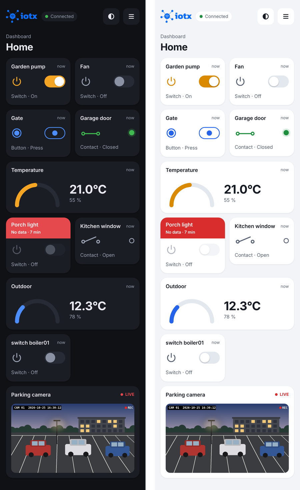

## Components

| Folder | What it is | Technology |
|---|---|---|
| [`IotxApp`](IotxApp) | Web app (dashboards and administration) | React 18, Vite, react-bootstrap, mqtt.js |
| [`IotxApiServer`](IotxApiServer) | API: login, users, dashboards, devices, cameras, MQTT credentials | Node.js, Express, TypeScript, PostgreSQL |
| [`IotxVideoProxyServer`](IotxVideoProxyServer) | Serves the camera streams to the app (MJPEG), with signed access tokens | Node.js, Express, ffmpeg |
| [`IotxStreamWriter`](IotxStreamWriter) | Records camera streams | Node.js, ffmpeg |
| [WeMosIOT](https://github.com/StarNiell/WeMosIOT) | Firmware of the devices (separate repository) | ESP8266 / ESP32, PlatformIO |

Other parts of an installation: the **MQTT broker** (Mosquitto; TCP for the devices,
WebSocket for the app) and the **PostgreSQL** database.

```
 devices (WeMosIOT) ──MQTT──▶ broker ◀──MQTT over WebSocket── IotxApp (browser)
                                                                │      │
                                                     HTTP (API) │      │ HTTP (MJPEG)
                                                                ▼      ▼
                               PostgreSQL ◀── IotxApiServer   IotxVideoProxyServer ◀── cameras (RTSP)
```

## Devices: WeMosIOT

[**WeMosIOT**](https://github.com/StarNiell/WeMosIOT) is the reference project for the
devices integrated in IoteXperience: firmware for ESP8266 boards (WeMos D1) with
experimental ESP32 support. A device can be a **switch**, a **button** (short pulse), a
**contact** (any on/off input) or a **sensor** (temperature and humidity). It is set up from
its own web page (access-point mode on first start), connects to Wi-Fi and to the broker,
publishes its state and receives commands:

- state: topic `iotx/out/<type>-<id>`, retained, when it connects and then every 60 seconds;
- commands: topic `iotx/in`, payload `{"device_id": "<id>", "value": <n>}`.

Any device that follows the same MQTT messages shows up in IotxApp (*Administration →
Devices*) and can be put on a dashboard.

## The app

### Dashboards

Each widget shows the age of its data; the header turns **red** when the connection is
lost or the device has not sent anything recently, and its command is disabled. The
indicator next to the logo shows the connection state. Switches wait for the device to
confirm the new state; buttons send a short pulse.

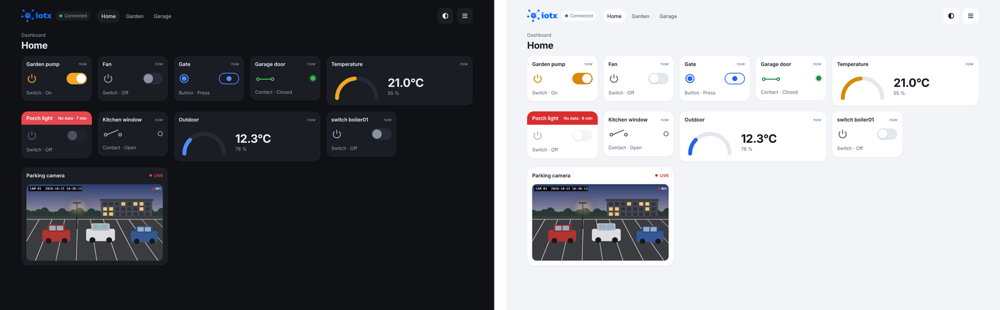

| Sign in | Home | Menu |
|---|---|---|
| 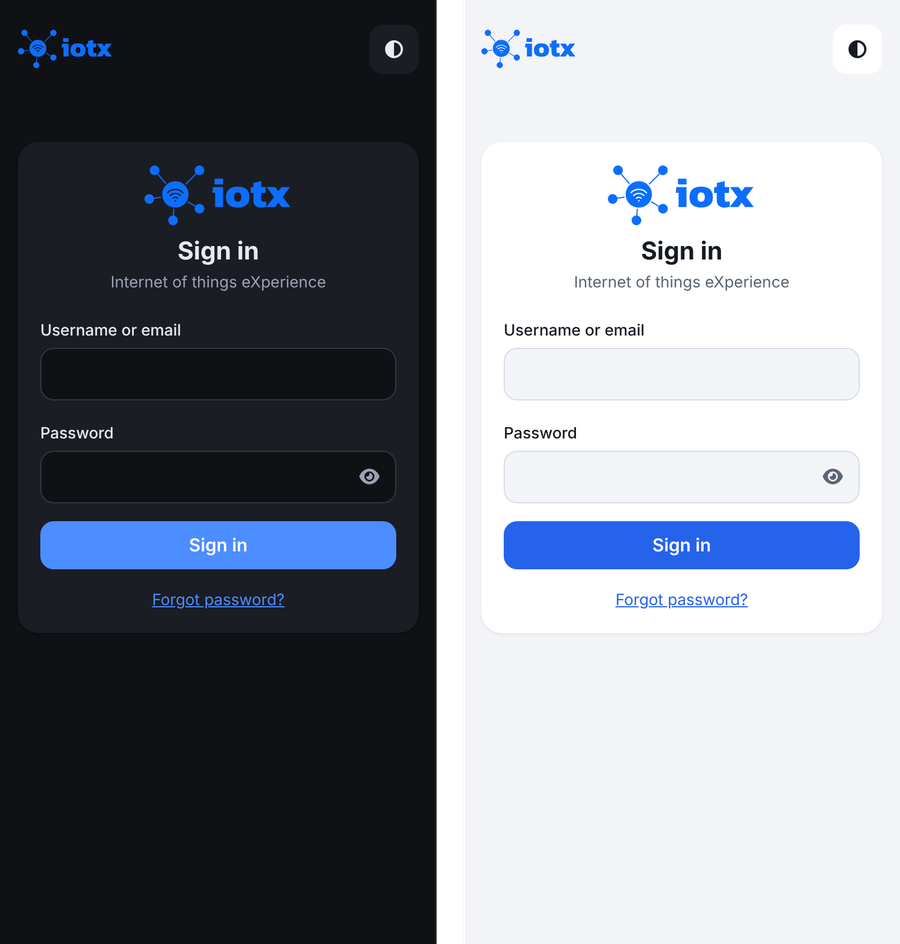 | 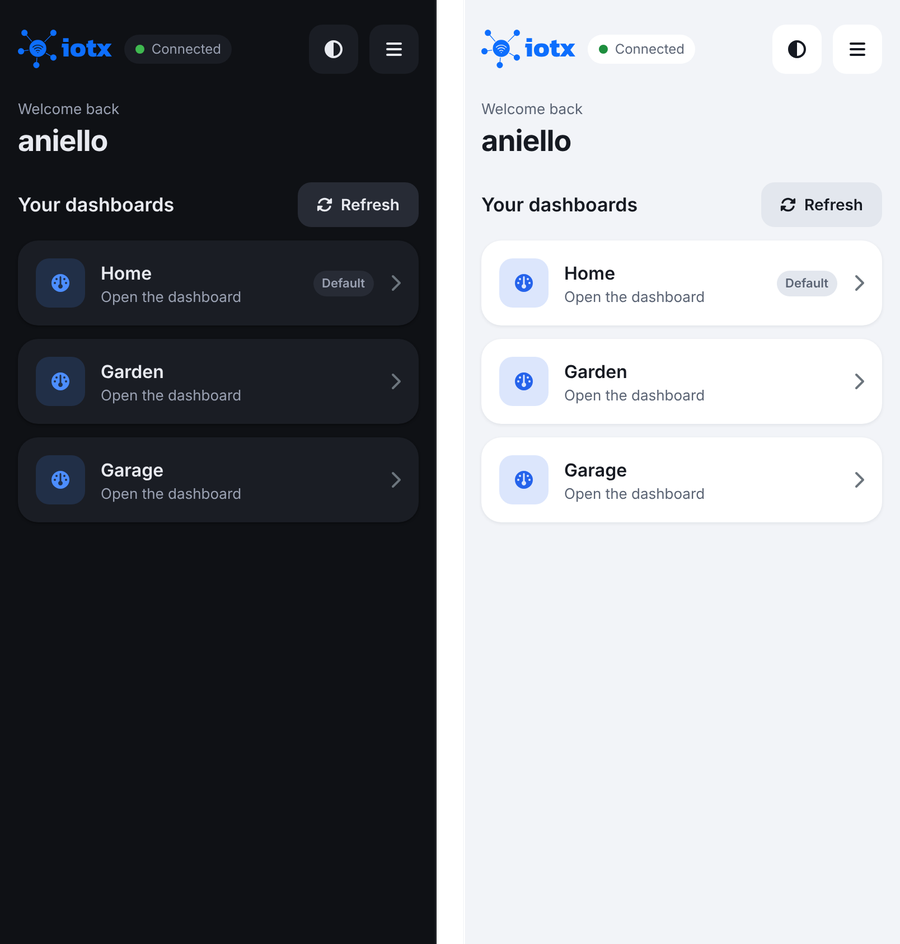 | 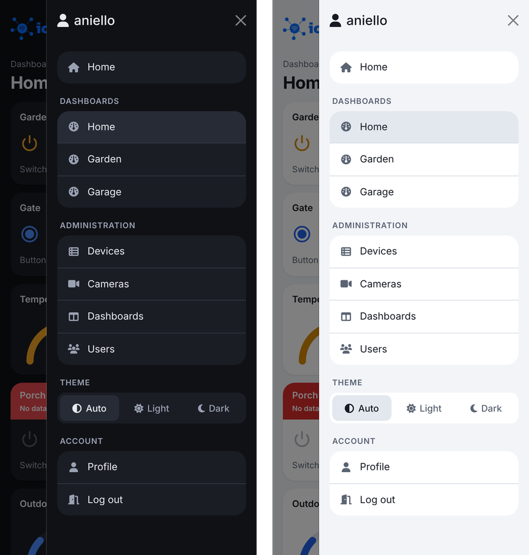 |

### Administration

Administrators manage devices, cameras, dashboards and users from the app, on a phone too.

| Devices | Edit a device |
|---|---|
| 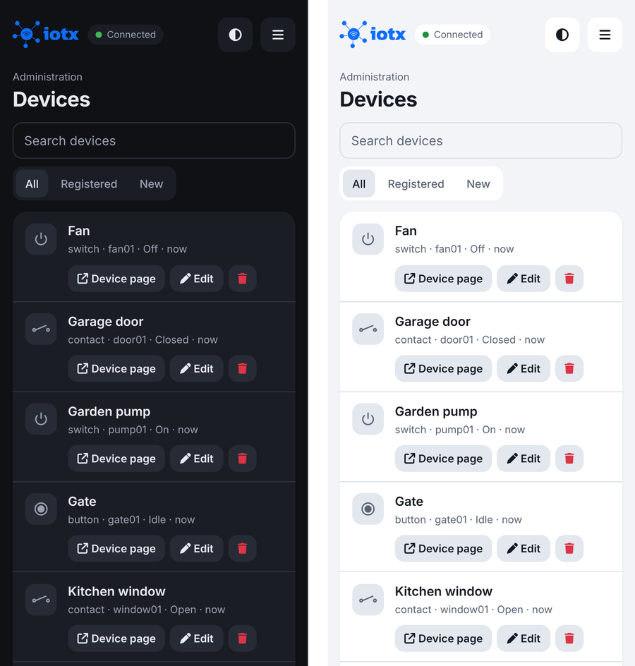 | 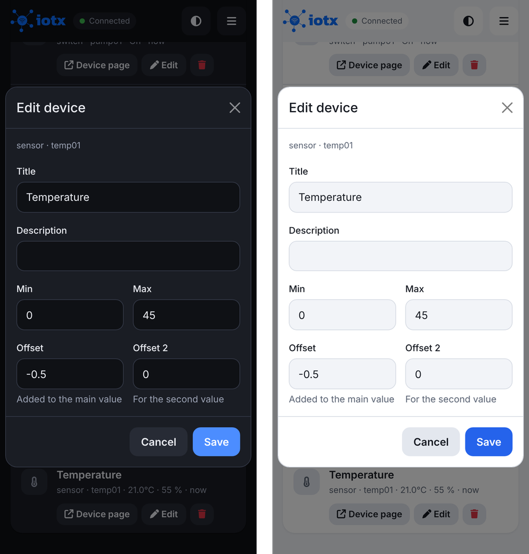 |

| Dashboards | Users of a dashboard |
|---|---|
| 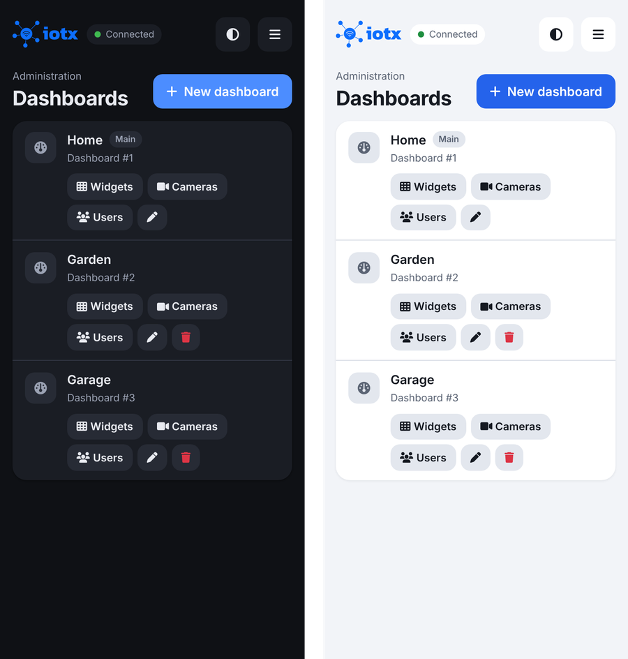 | 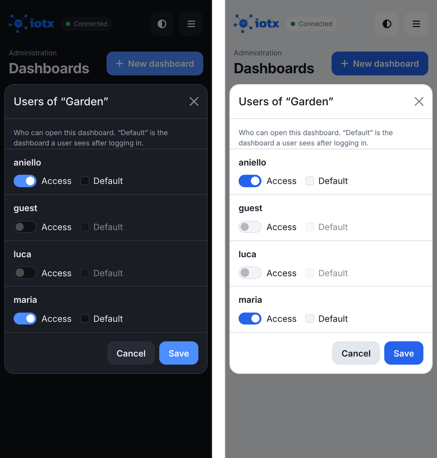 |

| Widgets of a dashboard | Cameras |
|---|---|
| 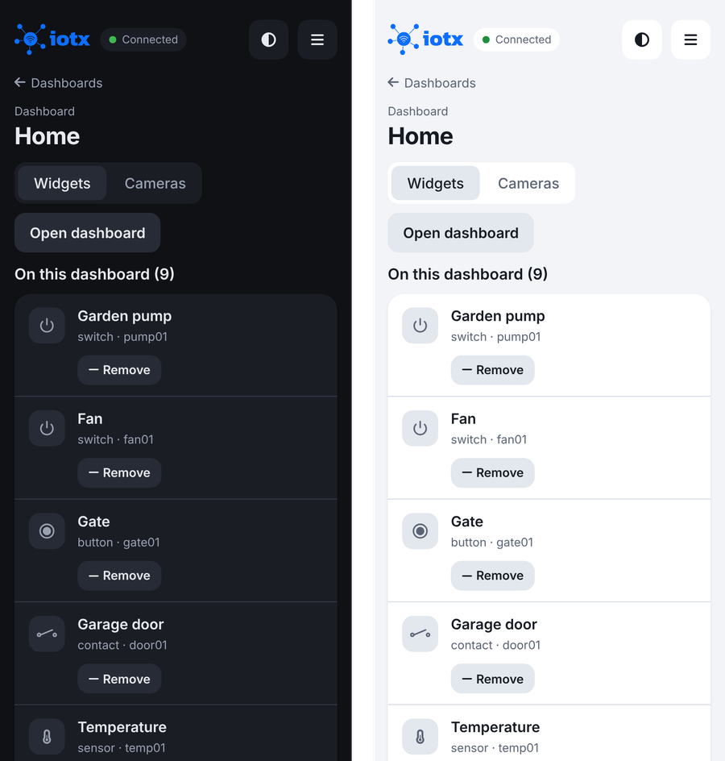 | 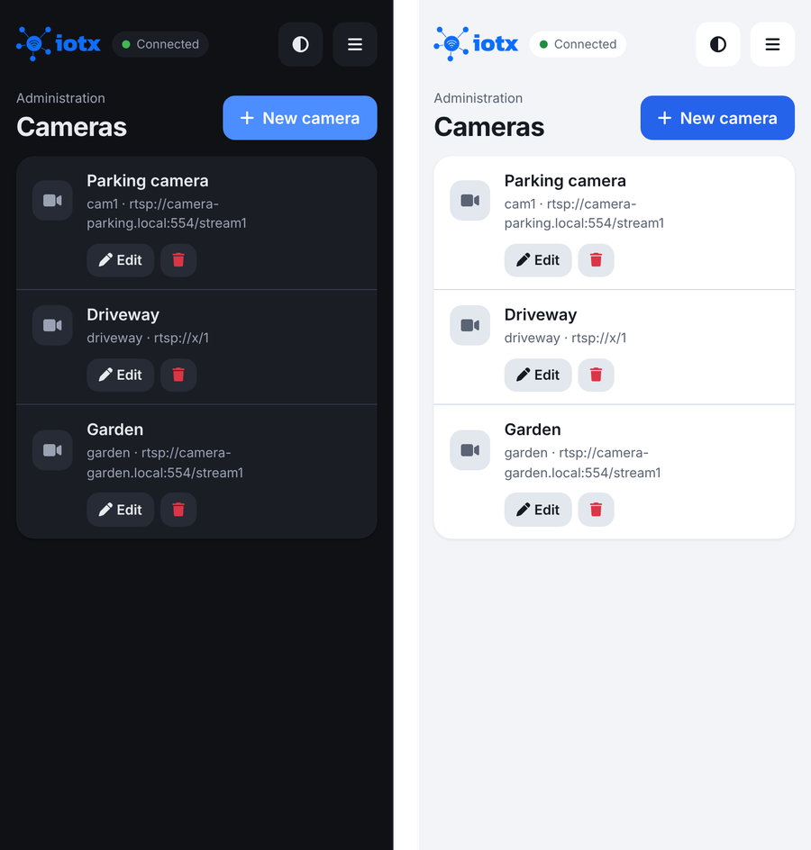 |

| Users | Profile |
|---|---|
| 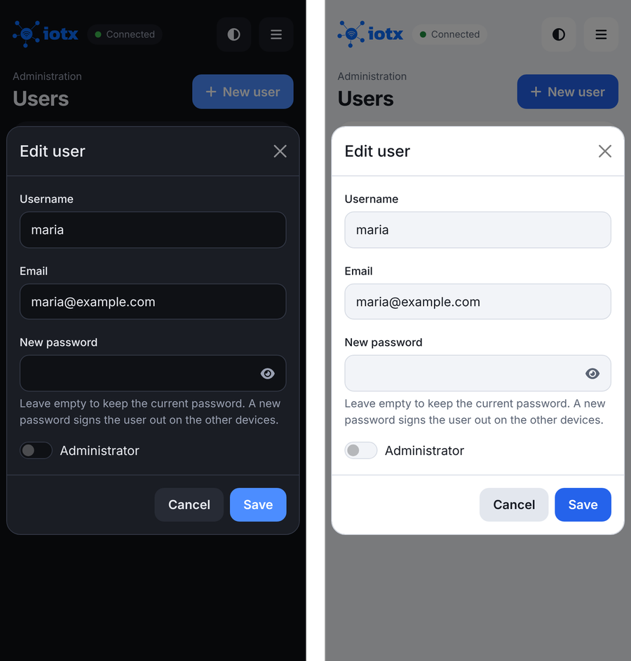 | 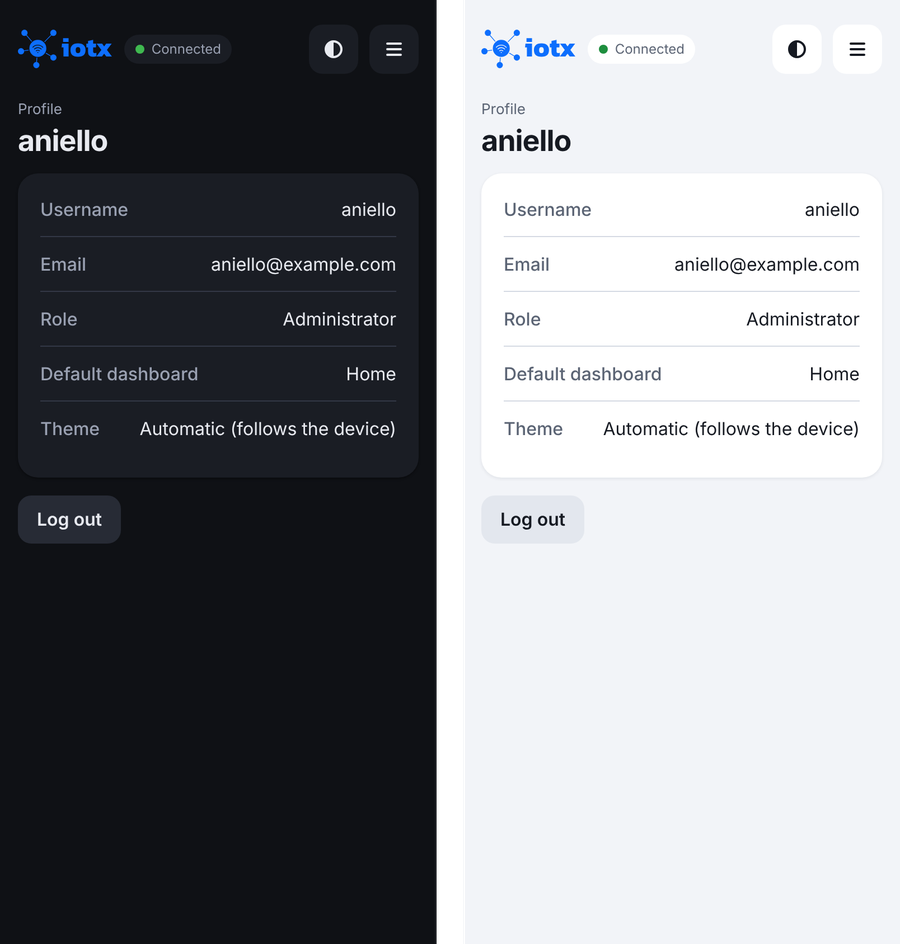 |

*Screenshots: test data. The camera picture is an illustration made for this README.*

## Getting started

Each component has its own settings file, kept out of git, with an example next to it:

- `IotxApiServer/.env` (from `.env.example`): database, port, stream token secret, MQTT account for the app;
- `IotxVideoProxyServer/.env` and `config.js` (from the examples);
- `IotxApp/public/config.json` in development, `IotxApp/dist/config.json` in production
  (from `IotxApp/config.example.json`): see the [IotxApp README](IotxApp/README.md).

Development: start the API (`npm start` in `IotxApiServer`), the video proxy if you need the
cameras, then the app (`npm run dev` in `IotxApp`).
